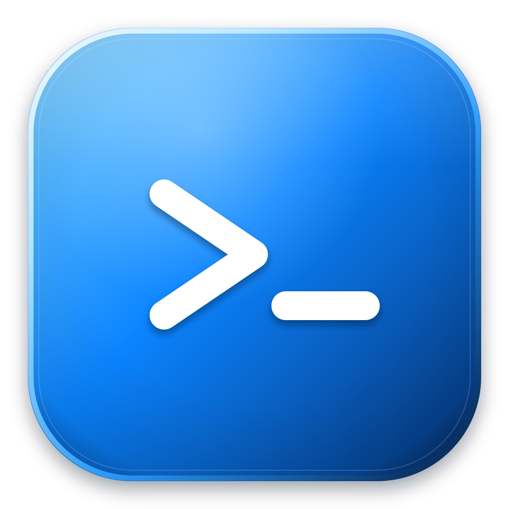

<p align="center">
  
</p>

<h1 align="center">idev</h1>

<p align="center">
  <strong>Build, run, and ship iOS apps from Linux.</strong><br>
  One CLI for SwiftUI, Expo, React Native, Flutter, and Kotlin Multiplatform.
</p>

`idev` installs a private iOS toolchain under `~/.local/share/idev`, then wraps
xtool, the Darwin tools, and your project's build system. Setup, diagnostics,
devices, shipping, updates, and coding-agent support come from one command.

## What it does

- **One private toolchain.** Swift, xtool, pymobiledevice3, rcodesign, and ipsw
  live under `IDEV_HOME`. System packages come from your package manager.
- **Know the next step.** `idev next` reads the host and prints what to run next.
  `idev doctor` shows the full report.
- **Real devices.** Build, sign, install, and launch on a USB iPhone or iPad.
- **Project-native.** Expo, React Native, Flutter, KMP, and SwiftUI projects stay
  ordinary apps; idev adds no project dependency.
- **Agent-ready.** `idev agents install` adds the embedded skill to Claude Code
  and Codex. `next`, `doctor`, updates, and device state support `--json`.

## Get started

### With your agent

Paste this into Claude Code, Codex, or another coding agent:

```text
Set up idev on this machine: https://github.com/tekibo/idev. Follow the repository instructions and ask me before changing the host.
```

### By hand

```bash
curl -fsSL https://github.com/tekibo/idev/releases/latest/download/install.sh | sh
idev next
```

`idev next` walks through the remaining setup: system packages, the private
toolchain, `Xcode.xip`, the Darwin SDK, and project flows. The installer verifies
the release SHA-256 and writes `~/.local/bin/idev`; set `IDEV_INSTALL_DIR` to
change the destination.

### What you need

- Linux on x86_64 or arm64 with pacman, apt, or dnf.
- `Xcode.xip` downloaded from Apple.
- For device runs: a USB iPhone or iPad with Developer Mode enabled.
- For the iPad viewer: Tailscale running (`sudo systemctl enable --now tailscaled`),
  signed in (`tailscale up`), and Serve operator permission.

## Commands

| Task | Command |
|---|---|
| Setup state | `idev next`, `idev next --json` |
| Diagnostics | `idev doctor`, `idev doctor --json` |
| Setup | `idev setup --base`, `idev setup --flow <name>` |
| System packages | `idev system plan`, `idev system apply` |
| Xcode and SDK | `idev xcode import`, `idev sdk install` |
| SwiftUI | `idev swift run`, `idev device-run`, `idev ship` |
| Expo | `idev expo run:ios`, `idev expo start` |
| React Native | `idev rn run-ios`, `idev rn start` |
| Flutter | `idev flutter build`, `idev flutter ship` |
| KMP | `idev kmp` |
| Devices | `idev devices`, `idev install-app`, `idev launch-app` |
| Apple account | `idev auth status`, `idev auth login` |
| iPad viewer | `idev ipad-screen start`, `idev ipad-screen status` |
| Ship | `idev ship`, `idev asc` |
| Updates | `idev update check`, `idev update apply --all`, `idev update clean` |
| Agents | `idev agents install`, `idev agents status` |

`idev help` and `idev help <command>` document every option, including nested
subcommands.

## Updates

Paste this into your agent:

```text
Update idev on this machine to the latest version: https://github.com/tekibo/idev. Follow the update instructions in the repository and ask me before changing the host.
```

Or by hand:

```bash
idev update check
idev update apply --all
```

`update apply --all` verifies the release SHA-256, updates outdated components,
reconciles the manager, and refreshes an installed agent skill. Restart `idev`
after the manager changes.

`idev update clean` lists update downloads and build caches, asks before removing
them, and keeps the SDK, auth, config, state, xips, and installed payloads. Use
`--dry-run` to inspect and `--yes` for non-interactive runs.

## Agents

`idev agents install` writes the embedded skill to `$IDEV_HOME/skills/idev` and
links it into `~/.claude/skills` and `~/.agents/skills`. The skill covers setup,
updates, cleanup, SwiftUI, Expo, Flutter, KMP, devices, shipping, the iPad
viewer, and troubleshooting. `idev agents status` reports a stale copy.

## Docs

- [Install and setup](docs/INSTALL.md)
- [Components](docs/COMPONENTS.md)
- [Doctor](docs/DOCTOR.md)
- [Uninstall](docs/UNINSTALL.md)
- [Agent usage](docs/AGENT-USAGE.md)

## Credits

`idev` builds on [omarchy-apple-dev](https://github.com/joshuaswarren/omarchy-apple-dev),
xtool, and the upstream Flutter, React Native, and Kotlin Multiplatform
toolchains. Their licenses remain their own.

## License

MIT. See [LICENSE](LICENSE).
